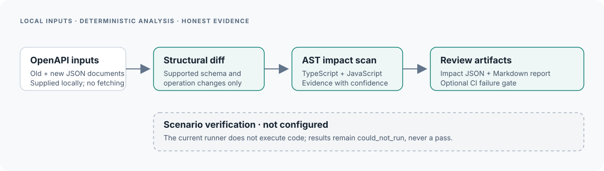
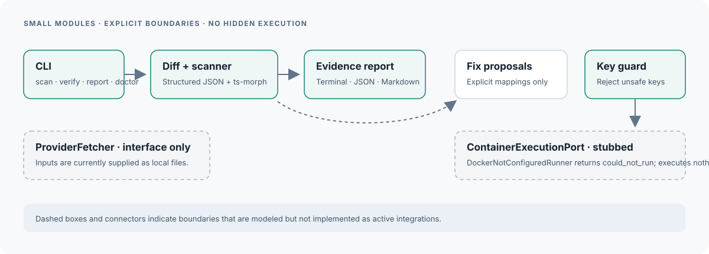

# ApiProof

ApiProof is an early, local-first CLI and GitHub Action for detecting structural changes between Stripe OpenAPI documents and finding likely affected TypeScript and JavaScript call sites. It produces machine-readable impact data and Markdown evidence for code review.

**Current limitation:** scenario verification is not implemented end to end. The `verify` command checks key safety, then returns `could_not_run` because the isolated execution runner is a deliberate stub. ApiProof does not claim that a scan proves an application is safe.

## What works today

| Area                  | Available now                                                                                                                                                                                                 | Not covered / not yet available                                                                                                                  |
| --------------------- | ------------------------------------------------------------------------------------------------------------------------------------------------------------------------------------------------------------- | ------------------------------------------------------------------------------------------------------------------------------------------------ |
| Change detection      | Compare supplied OpenAPI JSON for supported schema and operation changes, including removals, requiredness increases, type changes, and enum-value removals. Local component-schema references are supported. | Fetching Stripe inputs, external or nested JSON Pointer references, parameter constraints, referenced parameter schemas, and behavioral changes. |
| Impact scan           | Use `ts-morph` to inspect TypeScript/JavaScript and report likely call sites for statically identified Stripe clients. Findings include evidence and confidence.                                              | Dynamic client construction, reflection, REST calls, generated/vendor code, and a complete map from resource-level changes to call sites.        |
| Fix proposals         | A library interface can propose a deterministic rename only when an explicit old-to-new mapping is supplied. Unsupported changes return `needs_human`.                                                        | Rename discovery, general-purpose fixes, and a CLI command that applies patches.                                                                 |
| Scenario verification | Validate scenario input and reject live or unrecognized Stripe key formats before any scenario execution.                                                                                                     | Executing old/new application scenarios. The current runner always reports `could_not_run`; no behavior comparison is performed.                 |
| Reports and Action    | Write JSON impact data and Markdown evidence. The Docker-based GitHub Action runs a scan against workspace-relative OpenAPI files.                                                                            | Automatic provider retrieval, PR comments, and a production-ready verification runner.                                                           |
| Benchmarks            | A 20-repository data model and harness that reports results as unmeasured.                                                                                                                                    | External benchmark results; none are claimed.                                                                                                    |

AST results are evidence, not proof of runtime behavior. A scan that finds no impact is not proof that no impact exists. Review the report's coverage limitations before relying on it.

## Data flow



## Architecture



The CLI coordinates modules under `src/`: `diff` compares structured documents, `scanner` inspects source syntax, `fixes` contains constrained proposal logic, `verifier` defines key-safety and execution boundaries, and `reporter` formats evidence. Provider retrieval and repository execution are represented by interfaces; they are not implemented as live network fetching or host execution.

## Website

The public site in [`site/`](site/) is a single-page Next.js document covering what ApiProof is, what it does, its current limits, setup, usage, and verifiable differences. It is optional for using the CLI. Former topic routes redirect into the matching section.

```bash
cd site
npm ci
npm run dev
```

Run `npm run lint`, `npm run type-check`, `npm test`, and `npm run build` in `site/` before shipping changes. See [`site/README.md`](site/README.md) for structure and content rules, and [`DESIGN.md`](DESIGN.md) for the visual contract.

## Requirements and setup

- Node.js 20 or newer
- npm

```bash
git clone https://github.com/D1bakar/Dokimana.git
cd Dokimana
npm ci
npm run build
npm start -- doctor
```

For development, run the CLI source through `tsx`:

```bash
npm run dev -- doctor
npm run dev -- --help
```

## CLI

### Scan two OpenAPI documents

The checked-in fixture pair is synthetic and exists for demonstration and tests; it is not a Stripe release baseline.

```bash
npm run dev -- scan \
  --repo . \
  --old fixtures/stripe-old.json \
  --new fixtures/stripe-new.json \
  --old-version fixture-old \
  --new-version fixture-new \
  --json apiproof-impact.json \
  --markdown apiproof-evidence.md
```

`scan` reports detected structural changes and likely impact findings. Add `--fail-on-changes true` to return exit code 1 when structural changes are found. Reports are written before that failure gate is applied.

### Create a Markdown report from impact JSON

```bash
npm run dev -- report \
  --repo . \
  --impact apiproof-impact.json \
  --provider-version fixture-new \
  --output apiproof-evidence.md
```

### Check key safety and verification status

```bash
npm run dev -- doctor
npm run dev -- verify --repo . --scenario ./scenario.json --json verification.json
```

`doctor` checks `STRIPE_SECRET_KEY`. `verify` requires a scenario JSON object with `id`, `name`, `description`, `apiVersion`, `operation`, and an object-valued `input`; `expectedOutput` is optional. Until an isolated runner is implemented, a valid scenario still returns `could_not_run` and exits unsuccessfully. Do not interpret that result as a test pass.

## GitHub Action

The Action scans supplied old/new OpenAPI JSON files in the checked-out workspace and writes an impact JSON report plus a Markdown evidence report. This repository's example workflow uses the local Action:

```yaml
- uses: ./
  with:
    repo: .
    old-openapi: path/to/old-openapi.json
    new-openapi: path/to/new-openapi.json
    old-version: old-version-label
    new-version: new-version-label
    impact-output: apiproof-impact.json
    report-output: apiproof-evidence.md
    fail-on-changes: 'true'
```

The required inputs are `old-openapi`, `new-openapi`, `old-version`, and `new-version`. `repo`, `impact-output`, `report-output`, and `fail-on-changes` are optional. The default change gate is enabled. The Action does not download inputs or call Stripe; pin and review the OpenAPI inputs in your own workflow.

## Security and verification boundaries

- Live Stripe secrets (`sk_live`) are forbidden. `verify` scans environment values for live-key patterns and accepts only positively identified `sk_test_*` or `rk_test_*` values in Stripe key variables. Unrecognized formats are rejected.
- ApiProof does not make live Stripe API calls. The current CLI reads local files; provider retrieval remains an injectable interface.
- `verify` does not execute repository code today. `DockerNotConfiguredRunner` returns `could_not_run` without running the scenario.
- `docker-compose.yml` is an isolation-oriented example, not a configured verification engine. It does not make the current stub execute code.
- Any future repository execution must use an isolated container with no secrets, no network by default, a read-only source mount, resource limits, and no host Docker socket. Do not run untrusted repository scripts on the host.
- Never infer replacement API fields or semantics. If there is no explicit supported mapping, the safe outcome is human review.

## Development

```bash
npm ci
npm run build
npm test
npm run lint
npm run format:check
```

Tests use local fixtures; no Stripe credentials or external API calls are required. Site checks live in `site/` and run separately. Before contributing, read [`agent.md`](agent.md), [`AGENTS.md`](AGENTS.md), and [`HOW_TO_USE_GIT_GITHUB.md`](HOW_TO_USE_GIT_GITHUB.md). Research briefs and their sources are indexed in [`research/`](research/README.md).

## Benchmark status

`npm run benchmark` prints the 20-repository benchmark template with `measured: false` and `status: not_run`. These are empty slots, not measured outcomes. Do not cite them as validation results.

## Roadmap

The following are proposed next steps, not existing capabilities:

1. Define and review pinned Stripe OpenAPI inputs and supported-version scope.
2. Expand AST coverage with representative fixtures and explicit coverage reporting.
3. Implement and threat-model an isolated container runner before executing repository code.
4. Add reproducible test-mode scenarios and explicit output normalization.
5. Add only reviewed, evidence-backed fix mappings.
6. Run a public benchmark against reviewed ground truth and publish measured results and limitations.
